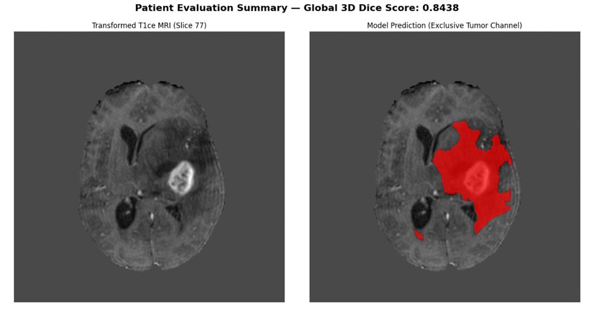
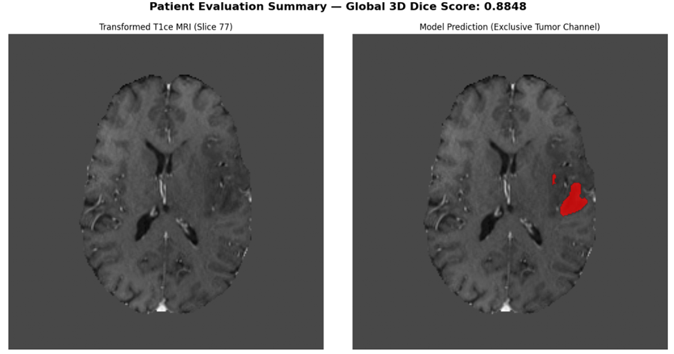

# 3D Brain Tumor Segmentation (BraTS) - PyTorch & MONAI

> **Status: Active Development**
> *This repository contains a 3D Deep Learning pipeline applied to volumetric medical imaging.*

## Project Objective
The goal of this project is to develop a 3D semantic segmentation pipeline capable of accurately identifying brain tumor sub-regions (Whole Tumor, Tumor Core, Enhancing Tumor) from multi-modal MRI scans (T1, T1ce, T2, FLAIR). 

This work is based on the benchmark **BraTS** dataset and leverages the **MONAI** (Medical Open Network for AI) framework natively in **PyTorch**.

## Hardware Environment & Reproducibility
To bypass local hardware bottlenecks and leverage high-performance GPUs for 3D processing, the training and inference pipelines are optimized for cloud compute environments (currently executed via **Kaggle**).

- **Model Weights:** Due to GitHub's file size limitations, trained model checkpoints (`.pth` files) and the raw BraTS NIfTI datasets are not hosted in this repository.
- **Reproducibility:** The codebase is structured to be directly imported and run within a Kaggle notebook environment, pointing to the official BraTS dataset paths.

## Methodology and Architecture
The pipeline implements standard medical imaging engineering practices to ensure robust volumetric segmentation:

- **Deterministic Spatial Preprocessing:** Utilizing MONAI transforms to unify voxel spacing (`Spacingd`), normalize intensities independently per modality, and align tensors in physical space (RAS orientation).
- **Sliding Window Inference:** To overcome GPU VRAM limitations when processing massive 3D volumes, inference relies on spatial patches (e.g., 64x64x64) with a 50% overlap and Gaussian blending to prevent boundary artifacts.
- **Validation-Driven Checkpointing:** Model weights persistence is decoupled from training loss reduction. Checkpoints are saved based strictly on improvements to the **3D Dice Score** evaluated on an independent validation set, effectively preventing overfitting.

## Current Results
The current baseline model (a standard 3D U-Net architecture) demonstrates strong generalization capabilities on unseen patients, achieving global Dice scores of **~0.84 to ~0.89** on validation volumes.

*(Performance Overview: Transformed T1ce MRI vs. Model Prediction)*

> *Caption: Overlay of the exclusive tumor channel prediction (in red) on an axial slice of a T1ce MRI. Display generated directly from the inference pipeline.*

## Perspectives for Improvement (Next Steps)
With the current training dynamics showing a loss plateau around 0.81, ongoing development is focused on handling highly complex tumor geometries through:

1. **Architectural Upgrade:** Transitioning from the baseline U-Net to a State-of-the-Art (SOTA) residual architecture like **SegResNet** or **SwinUNETR** to mitigate vanishing gradients in deep networks.
2. **Deep Supervision:** Implementing a hybrid loss function (`DiceCELoss`) applied across multiple resolution scales of the decoder, forcing the network to extract geometric features earlier in the forward pass.
